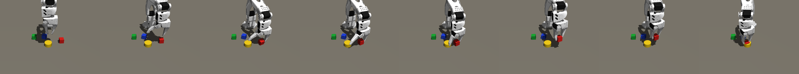

# so-arm100-sim

MuJoCo tabletop tasks, a scripted expert, domain randomisation and one evaluation protocol for the [SO-ARM100](https://github.com/TheRobotStudio/SO-ARM100) 5-DOF arm, CPU only. It is the shared bench under so-arm100-rl, -il and -vla, and fits servo kp and friction to public real-arm SO-100 recordings.



Scripted expert, 100 episodes × 5 seeds per cell, mean ± sd across seeds:

| task | success rule | steps | expert, nominal | expert, worst held-out cell |
|---|---|---|---|---|
| `reach` | end effector within 2 cm of a point 3 cm above the cube | 100 | 1.00 ± 0.00 | 1.00 ± 0.00 (all cells) |
| `push` | cube centre within 2.5 cm (xy) of the marker | 150 | 0.76 ± 0.07 | 0.73 ± 0.06 (`small`) |
| `lift` | cube 5 cm above its resting height **and** both jaws touching it | 150 | 0.93 ± 0.02 | 0.73 ± 0.05 (`small`) |
| `pick_place` | cube within 2.5 cm of the marker, on the table, released | 250 | 0.93 ± 0.01 | 0.72 ± 0.05 (`small`) |

Real2sim: kp fitted per episode on one pick-place dataset sits at median 35.7 (p10–p90 32.6–38.7); a second dataset gives 18.9–25.0, no overlap, and damping is not identifiable from either. Held-out physics cells, the real2sim fit and its limits: [docs/DETAILS.md](docs/DETAILS.md). Walkthrough: https://aungkaung1928.github.io/projects/so-arm100.html

## Quick start

Linux, Python 3.10+ (Ubuntu: the `python3-venv` package), CPU only.

```bash
git clone <this repo URL>
cd so-arm100-sim
python3 -m venv .venv && . .venv/bin/activate   # first time only
pip install -e ".[dev]"                         # first time only: mujoco, numpy, pytest
python -m pytest -q tests                       # 97 passed, 4 skipped (need GL or the real2sim extra), ~45 s
```

Measurement commands, demonstration recording and Docker: [docs/DETAILS.md#reproducing](docs/DETAILS.md#reproducing).

## How it works

1. `ArmEnv` / `VecEnv`: four tasks (reach, push, lift, pick_place), one success rule each, forked processes for throughput.
2. `DRConfig` and `EVAL_PHYSICS`: randomisation ranges for training and fixed held-out cells (heavy, slippery, weak, laggy, noisy, small) for evaluation.
3. `ScriptedExpert`: the demonstrator for imitation learning and the reference score every policy is compared with.

## License

MIT, see LICENSE.
